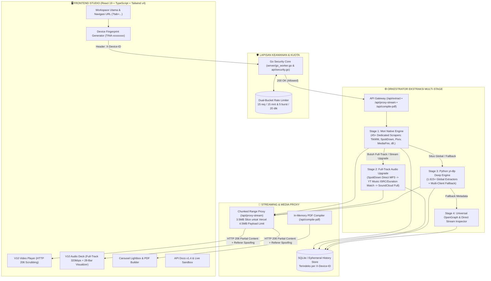

<div align="center">


<br />


# TINA DOWNLOADER
### **Platform Pengunduh Media Multi-Format, Resolusi Audio Full-Track 320kbps & Studio Ekstraksi Metadata Presisi Tinggi**

<p align="center">
  <strong>Dirancang dengan Arsitektur Tri-Engine (Node.js • Python • Go), Streaming Proxy HTTP 206 Anti-CORS, dan Sistem Desain Monokrom Anti-Slop</strong><br />
  Dikembangkan & Dikelola oleh <a href="https://github.com/NimzzAi"><strong>Nimzz (@NimzzAi)</strong></a>
</p>

<p align="center">
  <a href="https://tina.my.id">
    
  </a>
  <a href="https://whatsapp.com/channel/0029VbBhZWdGJP8HlbGaE63Q">
    
  </a>
  <a href="https://github.com/NimzzAi/tina">
    
  </a>
  <a href="https://t.me/Nimzz4">
    
  </a>
</p>

<p align="center">
  
  
  
  
  
  
  
  
  
</p>

---

[✨ Fitur Utama](#-fitur-unggulan-studio-v105) •
[🏛️ Arsitektur Sistem](#️-arsitektur-tri-engine--dual-runtime) •
[🎵 Audio Full-Track & HTTP 206](#-rekayasa-audio-full-track-320kbps--streaming-http-206) •
[🎨 Sistem Desain Monokrom](#-sistem-desain-monokrom--anti-slop-ui) •
[🌐 45+ Native Scraper & 1.615+ Situs](#-ekosistem-45-native-scraper--1615-ekstraktor-global) •
[📡 Dokumentasi REST API v1.4](#-dokumentasi-lengkap-rest-api-v14) •
[💻 Contoh Kode Multi-Bahasa](#-panduan-integrasi-sdk-multi-bahasa) •
[🛡️ Keamanan & Rate Limiter](#️-keamanan-ip-rate-limiting--device-fingerprinting) •
[🚀 Instalasi & Deployment](#-instalasi-konfigurasi--deployment) •
[👨‍💻 Profil Pengembang](#-tentang-pengembang-nimzz)

</div>

---

## 📖 Ikhtisar Eksekutif

**Tina Downloader** adalah platform ekstraksi media, dekoder aliran video/audio resolusi tinggi, kompilator komik/galeri ke PDF, dan mesin pengindeks metadata berskala produksi yang dibangun oleh **Nimzz (`@NimzzAi`)**. Berbeda dari situs pengunduh konvensional yang dipenuhi iklan pop-up, batasan pratinjau audio 29 detik, atau kegagalan pemutaran akibat blokir tanda tangan IP CDN (`403 Forbidden`), Tina Downloader mengimplementasikan **Arsitektur Tri-Engine Hibrida** yang memadukan kecepatan *native scraper* Node.js, kedalaman ekstraksi Python (`yt-dlp`), serta proteksi *rate-limiting* konkurensi tinggi berbasis Go (`Golang`).

Seluruh antarmuka pengguna dibangun di atas filosofi **Editorial Swiss Grid & Monokromatis Murni (Hitam • Putih • Abu-abu)** yang mengadaptasi standar rekayasa antarmuka dari:
- [**pbakaus/impeccable**](https://github.com/pbakaus/impeccable) — Presisi tipografi, keseimbangan ruang negatif, dan hierarki informasi tanpa distraksi visual.
- [**LeoStehlik/no-slop-ui**](https://github.com/LeoStehlik/no-slop-ui) — Eliminasi dekorasi generik AI (*zero neon glow*, *zero gradient soup*, *zero glassmorphism gimmick*), digantikan oleh garis struktural tegas `1px solid`, kontras tinggi, dan komponen fungsional murni.
- [**github/awesome-copilot (anti-ui-slop)**](https://github.com/github/awesome-copilot/tree/main/skills/anti-ui-slop) — Disiplin metrik angka `tabular-nums`, kepadatan kontrol tingkat instrumen studio, serta umpan balik status yang lugas.

---

## ✨ Fitur Unggulan Studio (v10.5)

<table>
  <tr>
    <td width="50%" valign="top">
      <h3>🎬 1. V10 Custom Video Player & Range Proxy</h3>
      <p>Pemutar video terintegrasi dengan dukungan <strong>HTTP 206 Partial Content</strong>, <em>timeline scrubbing</em> presisi, pemilihan kecepatan putar (<code>0.5x</code> – <code>2.0x</code>), <em>Picture-in-Picture (PiP)</em>, kontrol volume bertingkat, pemintasan otomatis referer CDN, serta pengunduhan langsung dengan nama berkas bersih.</p>
    </td>
    <td width="50%" valign="top">
      <h3>🎧 2. V10 Audio Deck (Full-Track 320kbps)</h3>
      <p>Bukan sekadar potongan preview 29 detik! Mesin resolusi audio multi-tahap (<em>SpotiDown Direct MP3</em> + <em>YouTube Music ISRC/Title Resolver</em>) mengekstrak <strong>lagu utuh dari awal hingga akhir (3–5+ menit)</strong> lengkap dengan sinkronisasi durasi <code>onLoadedMetadata</code> dan visualisasi 28-bar spektrum frekuensi.</p>
    </td>
  </tr>
  <tr>
    <td width="50%" valign="top">
      <h3>🖼️ 3. Galeri Carousel Interaktif & PDF Compiler</h3>
      <p>Mendukung ekstraksi <em>multi-slide</em> dari TikTok Slide, Instagram Carousel, Pixiv, Pinterest, hingga chapter komik (MangaDex, Kiryuu, KomikCast). Dilengkapi <strong>Full-Screen Lightbox</strong> dan fitur <strong>Kompilasi 1-Klik ke Dokumen PDF</strong> langsung dari browser atau API.</p>
    </td>
    <td width="50%" valign="top">
      <h3>🗂️ 4. Riwayat Arsip Tanpa Login & 1-Click Replay</h3>
      <p>Setiap ekstraksi diikat secara otomatis ke <strong>Device Fingerprint ID (<code>TINA-xxxx</code>)</strong> tanpa perlu registrasi akun. Dilengkapi pencarian instan, filter tipe media (<em>Video / Audio / Galeri</em>), salin tautan sumber, serta tombol <strong>Buka & Putar di Studio</strong> tanpa <em>reload</em> halaman.</p>
    </td>
  </tr>
  <tr>
    <td width="50%" valign="top">
      <h3>🌐 5. Direktori 1.615+ Situs & Pencarian Cepat</h3>
      <p>Katalog interaktif yang memuat lebih dari <strong>1.615 domain ekstraktor terverifikasi</strong> yang dikelompokkan ke dalam 6 kategori utama (Sosial & Video, Musik & Audio, Cloud & Berkas, Komik & Anime, Ekstraktor Global) dengan pencarian <em>real-time</em> berlatensi nol.</p>
    </td>
    <td width="50%" valign="top">
      <h3>⚡ 6. REST API v1.4 & Interactive Sandbox</h3>
      <p>Halaman dokumentasi API kelas produksi dengan <strong>Mode Ganda (Live API Tester & Dokumentasi Endpoint)</strong>, inspektur <em>Response Headers</em>, tabel skema parameter & kode status HTTP, serta contoh integrasi siap pakai dalam <strong>6 bahasa pemrograman</strong>.</p>
    </td>
  </tr>
</table>

---

## 🏛️ Arsitektur Tri-Engine & Dual-Runtime

Tina Downloader dirancang agar dapat berjalan secara **identik dan mulus** di dua lingkungan eksekusi yang berbeda:
1. **Mode Full-Stack Server (VPS / Docker / Dedicated Node.js)** — Ditenagai oleh `server.ts` (Express 4 + Vite + Python Subprocess + Go Security Binary + SQLite).
2. **Mode Cloud Serverless (Vercel Edge & Python/Go Functions)** — Ditenagai oleh `api/extract.py` (Python WSGI Serverless) dan `api/security.go` (Go Serverless Rate Limiter).

### Diagram Alir Arsitektur Sistem



### Perbandingan Mode Runtime

| Komponen Sistem | Mode VPS / Full-Stack (`server.ts`) | Mode Vercel Serverless (`vercel.json`) |
| :--- | :--- | :--- |
| **Gateway Utama** | Express.js (`server.ts`) pada Port `3000` | Python Serverless (`api/extract.py`) & Go (`api/security.go`) |
| **Ekstraktor Primer** | `mori-engine.js` (45+ Scraper) + `py_engine.py` | Multi-Provider Python Engine + `yt_dlp` Python Module + Cobalt/Piped |
| **Resolusi Audio Utuh** | SpotiDown + `ytsearch5:` Duration Matcher + SoundCloud | SpotiDown + `yt_dlp` Search + Piped Audio Stream + Deezer/iTunes Match |
| **Streaming Media** | *Direct Pipe* dengan terusan header `Range` penuh | *Chunked Range Slicing* (`3.5 MB` per segmen) agar lolos batas payload Vercel `4.5 MB` |
| **Penyimpanan Riwayat** | Persisten di `server/data/tina.sqlite` | In-Memory Store (`/tmp`) + Sinkronisasi Otomatis `localStorage` Klien |
| **Navigasi SPA** | History API (`?tab=...`) + Express Catch-All | Rewrite Rules di `vercel.json` ke `/index.html` (Anti-404 saat Refresh) |

---

## 🎵 Rekayasa Audio Full-Track 320kbps & Streaming HTTP 206

Salah satu masalah terbesar pada pengunduh web berbasis *serverless* (seperti Vercel) adalah:
1. **Jebakan Preview 29 Detik**: API publik Spotify (`open.spotify.com/embed`), iTunes Search, dan Deezer hanya mengembalikan potongan pratinjau `preview_url` berdurasi **29–30 detik**.
2. **Pemutusan Stream oleh CDN (`403 Forbidden` / CORS)**: URL unduhan langsung dari YouTube (`googlevideo.com`), TikTok, atau Instagram dikunci berdasarkan alamat IP mesin pengekstrak atau mewajibkan header `Referer` khusus.
3. **Batas Payload Serverless 4.5 MB**: Fungsi serverless Vercel akan memutus respons (`FUNCTION_PAYLOAD_TOO_LARGE`) jika server mencoba meneruskan berkas video/audio berukuran puluhan megabita sekaligus.

### Solusi Rekayasa Tina Downloader

#### 1. Pipeline Resolusi Audio Full-Track (Tanpa Terpotong 29 Detik)
Ketika pengguna memasukkan tautan **Spotify Track**, **SoundCloud**, atau **YouTube Music**, Tina Downloader menjalankan algoritma berjenjang:
- **Tahap A (Metadata & Durasi Presisi)**: Mengambil metadata resmi (Judul, Artis, Sampul Resolusi Tinggi, Tanggal Rilis, serta durasi asli lagu dalam detik, misalnya `215 detik` / `03:35`).
- **Tahap B (Direct MP3 Extraction)**: Menghubungi penyedia unduhan penuh (*SpotiDown / FabDL / SoundCloud Progressive Transcoding*) untuk mendapatkan berkas MP3 320kbps utuh.
- **Tahap C (Smart Full-Track Audio Matcher)**: Jika penyedia langsung hanya mengembalikan potongan 30 detik, mesin secara otomatis melakukan pencocokan silang (`Artist - Title Official Audio`) dengan memfilter kandidat yang memiliki selisih durasi `≤ 25 detik` dari durasi asli lagu, serta membuang video kompilasi/jam-jaman.
- **Tahap D (Sinkronisasi Durasi Pemutar)**: Komponen `V10AudioPlayer` membaca `audio.duration` aktual saat peristiwa `onLoadedMetadata` dan `onDurationChange` terjadi, sehingga bilah progres dan *timestamp* dijamin 100% akurat sesuai panjang audio yang diputar.

#### 2. Chunked HTTP 206 Partial Content Proxy (`/api/proxy-stream`)
Setiap aliran media yang memerlukan pemintasan CORS atau tanda tangan header dibungkus secara otomatis melalui endpoint `/api/proxy-stream`:
- Menyuntikkan header `Referer`, `Origin`, dan `User-Agent` yang sesuai dengan domain asal (`pixiv.net`, `tiktok.com`, `instagram.com`, dll.).
- Menerjemahkan permintaan `Range: bytes=start-end` dari elemen `<video>` dan `<audio>` browser menjadi potongan **maksimal 3.5 MB (`3,670,016 bytes`) per respons `206 Partial Content`**.
- Hasilnya: Video HD berdurasi panjang maupun lagu MP3 320kbps dapat diputar, digeser (*scrubbing* maju/mundur), dan diunduh dengan lancar baik di VPS maupun di Vercel Serverless!

---

## 🎨 Sistem Desain Monokrom & Anti-Slop UI

<div align="center">
  
</div>

Tina Downloader meninggalkan tren antarmuka generik berbasis warna-warni neon dan menerapkan **Monochrome High-Craft Design System** yang terinspirasi dari peralatan studio audio/video profesional (Teenage Engineering, Braun, Leica) dan tipografi Swiss.

### Prinsip Desain Utama
1. **Zero Color Noise**: Seluruh permukaan, tipografi, tombol aksi, lencana status, dan pemutar media menggunakan skala **Hitam Pekat (`#09090B`), Putih Bersih (`#FAFAFA`), dan Abu-abu Netral (`Zinc 100–900`)**.
2. **Garis Struktural Tegas (`1px Hairline Grid`)**: Menggunakan kontras batas `1px solid` dan bayangan offset geometris tajam (`shadow-hard: 3px 3px 0px`), bukan bayangan kabur berlebihan.
3. **Disiplin Tipografi Tiga Lapis**:
   - **Display & Heading (`Unbounded`)**: Tegas, berkarakter teknis, dan langsung menarik perhatian pada judul bagian serta angka metrik.
   - **Antarmuka & Editorial (`Onest`)**: Sangat nyaman dibaca pada ukuran kecil hingga sedang untuk deskripsi, tabel, dan panduan.
   - **Data Teknis & Kode (`JetBrains Mono` + `tabular-nums`)**: Digunakan pada URL, *timestamp* pemutar media, ukuran berkas, kode status HTTP, dan ID perangkat agar angka tidak bergeser saat berubah setiap detik.
4. **Dual Theme (Light Editorial & Dark Studio)**: Mendukung pergantian instan antara mode Terang (*High-Contrast Paper*) dan mode Gelap (*Carbon Studio*) yang disimpan secara persisten.

### Tabel Token Warna CSS (`src/index.css`)

| Token Variabel | Mode Terang (Light Editorial) | Mode Gelap (Dark Carbon Studio) | Kegunaan |
| :--- | :--- | :--- | :--- |
| `--bg-paper` | `#FAFAFA` (Zinc 50) | `#09090B` (Zinc 950) | Latar belakang kanvas utama aplikasi |
| `--bg-card` | `#FFFFFF` (Pure White) | `#121215` (Carbon Surface) | Permukaan kartu, modal, dan kontainer pemutar |
| `--bg-muted` | `#F4F4F5` (Zinc 100) | `#18181B` (Zinc 900) | Latar input, blok kode, dan baris tabel sekunder |
| `--text-ink` | `#09090B` (Zinc 950) | `#FAFAFA` (Zinc 50) | Teks utama, ikon aktif, dan judul berhirarki tinggi |
| `--text-muted` | `#52525B` (Zinc 600) | `#A1A1AA` (Zinc 400) | Label metadata, subjudul, dan teks penjelasan |
| `--border-line` | `#18181B` (Zinc 900) | `#27272A` (Zinc 800) | Garis tepi struktural kartu dan tombol utama |
| `--border-subtle` | `#E4E4E7` (Zinc 200) | `#1F1F23` (Zinc 850) | Pemisah baris tabel dan kisi internal |

---

## 🌐 Ekosistem 45+ Native Scraper & 1.615+ Ekstraktor Global

Selain mendukung **1.615+ situs global** melalui mesin `yt-dlp`, Tina Downloader memiliki **45+ modul *Native Scraper* khusus** di dalam `server/engines/mori-engine.js` dan `api/extract.py` untuk situs-situs yang memerlukan dekripsi token, pemintasan anti-bot, atau ekstraksi galeri/komik.

### Daftar Kategori & Platform Utama

| Kategori | Platform Unggulan yang Didukung | Kemampuan Ekstraksi Khusus |
| :--- | :--- | :--- |
| **📱 Sosial & Video Pendek** | **TikTok**, **Douyin**, **Instagram** (Reels/Post/Stories), **CapCut**, **Xiaohongshu (RedNote)**, **SnackVideo**, **Likee**, **Kwai**, **ShareChat**, **Triller** | Video kualitas asli **Tanpa Watermark (No-WM HD)**, ekstraksi *multi-slide photo carousel*, dan trek audio MP3 terpisah. |
| **🎬 Video Streaming & Portal** | **YouTube** (Video & Shorts), **Bilibili (Bstation)**, **Facebook Watch**, **X / Twitter**, **Threads**, **Reddit**, **Vimeo**, **Dailymotion**, **Twitch Clips**, **Rumble**, **Streamable**, **Coub**, **9GAG**, **TED**, **Archive.org** | Pemilihan multi-resolusi (`1080p`, `720p`, `480p`, `360p`), penggabungan aliran video+audio otomatis, dan ekstraksi *thumbnail* HD. |
| **🎵 Musik, Audio & Podcast** | **Spotify** (Track), **SoundCloud**, **YouTube Music**, **Apple Music**, **Deezer**, **Bandcamp**, **Mixcloud**, **Audiomack**, **ZingMP3**, **NetEase Cloud Music** | **Resolusi Audio Full-Track 320kbps MP3/M4A** (bukan preview 30 detik), metadata sampul album HD, nama artis, dan tanggal rilis. |
| **🎨 Seni, Foto & Desain** | **Pixiv** (Single & Multi-Page Manga/Illust), **Pinterest**, **DeviantArt**, **ArtStation**, **Behance**, **Flickr**, **Unsplash**, **Wallhaven**, **Zerochan**, **Danbooru**, **Gelbooru**, **Konachan**, **Yande.re** | Pemintasan proteksi `Referer` (`i.pximg.net`), resolusi asli tanpa kompresi, serta pratinjau galeri interaktif. |
| **☁️ Cloud Storage & Berkas** | **MediaFire**, **Google Drive**, **TeraBox**, **PixelDrain**, **GoFile.io**, **Mega.nz**, **KrakenFiles**, **Sfile.mobi**, **1Fichier**, **AnonFiles**, **BayFiles**, **WorkUpload** | Resolusi tautan unduhan langsung (*direct binary link*), pembacaan ukuran berkas, dan tipe MIME otomatis. |
| **📚 Komik, Manga & Anime** | **MangaDex**, **Kiryuu**, **KomikCast**, **KomikIndo**, **WestManga**, **Shinikami**, **Bato.to**, **Webtoons**, **NHentai**, **Otakudesu**, **Nimegami**, **Samehadaku**, **Anoboy**, **Gogoanime**, **Kuramanime** | Ekstraksi seluruh halaman *chapter* komik secara berurutan + fitur **1-Click Compile to PDF**, serta tautan episode anime multi-server. |
| **🔓 Link Shortener & Bypass** | **Linkvertise**, **LootLabs / Loot-Link**, **Sub2Unlock**, **Rekonise**, **Boost.ink**, **Mboost.me**, **Adf.ly**, **Ouo.io**, **SafelinkU**, **Pastebin** | Dekripsi dan pemintasan halaman tunggu (*ad-link bypass*) langsung menuju URL tujuan akhir. |

> 💡 **Catatan**: Daftar lengkap seluruh **1.615+ domain** dapat dijelajahi secara langsung melalui tab **Supported Sites (`/?tab=sites`)** di dalam aplikasi atau melalui endpoint `GET /api/supported-sites`.

---

## 📡 Dokumentasi Lengkap REST API v1.4

Tina Downloader menyediakan **REST API v1.4** yang terbuka bagi pengembang untuk mengintegrasikan kemampuan ekstraksi media ke dalam bot WhatsApp, bot Telegram, Discord, aplikasi mobile, maupun layanan backend lainnya.

### Informasi Dasar API

| Parameter | Nilai / Ketentuan |
| :--- | :--- |
| **Base URL Produksi** | `https://tina.my.id` (atau domain/IP server Anda, misal `http://localhost:3000`) |
| **Versi API** | `v1.4` |
| **Format Pertukaran Data** | `application/json; charset=utf-8` (kecuali endpoint streaming/unduhan biner) |
| **Autentikasi** | Tanpa API Key berbayar. Wajib menyertakan header `X-Device-ID` untuk kuota *rate-limit* dan sinkronisasi riwayat. |
| **Batas Kuota (Rate Limit)** | **15 permintaan / 15 menit** per IP & Device ID (dengan batas *burst* **5 permintaan / 20 detik**). |

### Ringkasan Seluruh Endpoint

| Metode | Endpoint | Deskripsi Singkat |
| :---: | :--- | :--- |
| `POST` | `/api/extract` | **Endpoint Utama**: Mengekstrak metadata lengkap, daftar resolusi video, audio full-track, dan galeri dari URL. |
| `GET` | `/api/proxy-stream` | **Streaming Proxy HTTP 206**: Memutar & mengunduh aliran video/audio/gambar dengan pemintasan CORS & Referer. |
| `POST` | `/api/resolve` | **On-Demand Stream Resolver**: Mengonversi token internal (`ytdlp_format:...` / `ytsearch_audio:...`) menjadi URL langsung. |
| `POST` | `/api/compile-pdf` | **Kompilator PDF**: Menggabungkan array URL gambar (slide/komik) menjadi satu dokumen PDF siap unduh. |
| `GET` | `/api/supported-sites` | **Direktori Situs**: Mengambil daftar 1.615+ situs yang didukung beserta filter kategori dan kata kunci pencarian. |
| `GET` | `/api/history` | **Ambil Riwayat**: Menampilkan daftar riwayat ekstraksi berdasarkan `X-Device-ID` pengguna. |
| `DELETE` | `/api/history` | **Hapus Riwayat**: Menghapus seluruh catatan riwayat ekstraksi milik `X-Device-ID` terkait. |
| `GET` | `/api/security` | **Status Keamanan & Kuota**: Memeriksa sisa kuota *rate-limit*, latensi Go Worker, dan validitas Device ID. |

---

### 1. `POST /api/extract` — Ekstraksi Media & Metadata Utama

Mengekstrak informasi lengkap dari satu tautan URL. Mendukung video, musik/audio utuh, galeri foto *carousel*, chapter komik, maupun berkas cloud.

#### Request Headers
```http
Content-Type: application/json
X-Device-ID: TINA-8F92A1C0
```

#### Request Body
```json
{
  "url": "https://open.spotify.com/track/0wULafSHeHYZFu54R9ZFRJ"
}
```

#### Contoh Respons Sukses (`200 OK` — Audio Full-Track)
```json
{
  "success": true,
  "data": {
    "id": "ext-1743291042",
    "title": "Evaluasi",
    "description": "Hindia — Menari Dengan Bayangan (Full-Track 320kbps Audio Stream)",
    "duration": 194,
    "thumbnail": "https://i.scdn.co/image/ab67616d0000b273a1b2c3d4e5f60718293a4b5c",
    "uploader": "Hindia",
    "upload_date": "20191129",
    "view_count": 0,
    "like_count": 0,
    "extractor": "Spotify",
    "webpage_url": "https://open.spotify.com/track/0wULafSHeHYZFu54R9ZFRJ",
    "Engine": "SpotiDown Full-Track 320kbps",
    "streams": [
      {
        "format_id": "spotify-mp3-320",
        "ext": "mp3",
        "resolution": "Audio 320kbps",
        "Quality": "Audio 320kbps (Full Track)",
        "Type": "audio",
        "filesize": 7760000,
        "url": "/api/proxy-stream?url=https%3A%2F%2F...&filename=Evaluasi.mp3",
        "has_audio": true,
        "has_video": false,
        "vcodec": "none",
        "acodec": "mp3"
      }
    ]
  },
  "rate_limit": {
    "remaining_15m": 14,
    "limit_15m": 15,
    "reset_in_seconds": 899
  }
}
```

---

### 2. `GET /api/proxy-stream` — Streaming & Download Proxy (HTTP 206)

Digunakan untuk memutar media langsung pada elemen `<video>` / `<audio>` atau memicu unduhan berkas (`Content-Disposition: attachment`) tanpa terblokir CORS atau proteksi `Referer`.

#### Query Parameters

| Parameter | Tipe | Wajib | Deskripsi |
| :--- | :---: | :---: | :--- |
| `url` | `string` | **Ya** | URL asli aliran media (harus di-*encode* dengan `encodeURIComponent`). |
| `filename` | `string` | Tidak | Nama berkas keluaran (misal: `Tina_Video_1080p.mp4` atau `Lagu.mp3`). |
| `download` | `0 \| 1` | Tidak | Jika `1`, memaksa browser mengunduh berkas (`attachment`). Jika `0` (default), mode streaming (`inline`). |

#### Contoh Pemanggilan
```http
GET /api/proxy-stream?url=https%3A%2F%2Fi.pximg.net%2Foriginal%2Fimg.jpg&filename=Pixiv_Artwork.jpg&download=1 HTTP/1.1
Host: tina.my.id
Range: bytes=0-1048575
```

---

### 3. `POST /api/compile-pdf` — Kompilasi Galeri & Komik ke PDF

Mengunduh serangkaian gambar secara paralel di sisi server (dengan pemintasan header `Referer` otomatis) lalu menyusunnya menjadi satu dokumen PDF terstruktur.

#### Request Body
```json
{
  "title": "Chapter_01_Komik",
  "images": [
    "https://i.pximg.net/img-original/img/2025/01/01/00/00/01_p0.jpg",
    "https://i.pximg.net/img-original/img/2025/01/01/00/00/01_p1.jpg"
  ]
}
```

#### Respons
Mengembalikan aliran biner `application/pdf` dengan header `Content-Disposition: attachment; filename="Chapter_01_Komik.pdf"`.

---

### 4. `GET /api/supported-sites` — Pencarian Direktori 1.615+ Situs

#### Query Parameters
- `category` *(opsional)*: `Semua` | `Sosial & Video` | `Musik & Audio` | `Cloud & Berkas` | `Komik & Anime` | `Ekstraktor Global`
- `q` *(opsional)*: Kata kunci pencarian nama situs atau domain (misal: `tiktok`, `spotify`, `pixiv`).
- `limit` *(opsional)*: Jumlah hasil maksimum (default: `200`, mendukung hingga `2000`).

---

### 5. `GET /api/history` & `DELETE /api/history` — Manajemen Riwayat Perangkat

Mengambil atau menghapus riwayat ekstraksi berdasarkan header `X-Device-ID` (atau parameter query `?deviceId=TINA-xxxx`). Tidak memerlukan akun pengguna atau *cookie* sesi.

---

### Kode Status HTTP & Penanganan Error

| Kode HTTP | Status | Arti & Penyebab | Solusi Penanganan |
| :---: | :--- | :--- | :--- |
| `200 OK` | **Success** | Ekstraksi metadata atau permintaan API berhasil diproses. | Baca objek `data` dan array `data.streams`. |
| `206 Partial Content` | **Streaming Chunk** | Potongan *byte range* video/audio berhasil dikirim oleh `/api/proxy-stream`. | Dikelola otomatis oleh pemutar HTML5 `<video>` / `<audio>`. |
| `400 Bad Request` | **Invalid Input** | Properti `url` kosong, format URL rusak, atau menggunakan protokol selain `http/https`. | Pastikan URL lengkap diawali `https://`. |
| `422 Unprocessable` | **Extraction Failed** | Konten bersifat privat, dihapus, memerlukan login khusus, atau diblokir regional. | Periksa apakah tautan dapat diakses secara publik tanpa akun. |
| `429 Too Many Requests` | **Rate Limited** | Melampaui batas 15 permintaan / 15 menit atau *burst* 5 permintaan / 20 detik. | Tunggu sesuai nilai `retry_after` (detik) pada respons JSON. |
| `502 Bad Gateway` | **Upstream Error** | Server CDN sumber mengalami gangguan atau menolak koneksi proksi. | Ulangi permintaan beberapa saat kemudian. |

---

## 💻 Panduan Integrasi SDK Multi-Bahasa

Berikut adalah contoh implementasi siap pakai dalam **6 bahasa pemrograman** untuk mengekstrak media menggunakan REST API Tina Downloader:

### 1. cURL (Command Line)
```bash
curl -X POST "https://tina.my.id/api/extract" \
  -H "Content-Type: application/json" \
  -H "X-Device-ID: TINA-CLI-9901" \
  -d '{
    "url": "https://youtu.be/Sgt6yH9UM-c"
  }'
```

### 2. JavaScript / TypeScript (Browser & Bun Fetch)
```typescript
interface ExtractResponse {
  success: boolean;
  data?: {
    title: string;
    uploader: string;
    duration: number;
    thumbnail: string;
    extractor: string;
    streams: Array<{
      format_id: string;
      ext: string;
      resolution: string;
      Type: 'video' | 'audio' | 'image';
      url: string;
    }>;
  };
  error?: string;
}

async function extractMedia(targetUrl: string): Promise<ExtractResponse> {
  const response = await fetch('https://tina.my.id/api/extract', {
    method: 'POST',
    headers: {
      'Content-Type': 'application/json',
      'X-Device-ID': 'TINA-WEB-SDK01',
    },
    body: JSON.stringify({ url: targetUrl }),
  });

  if (!response.ok) {
    throw new Error(`HTTP Error ${response.status}`);
  }
  return response.json();
}
```

### 3. Node.js (Axios — Cocok untuk Bot WhatsApp Baileys / Telegram / Discord)
```javascript
import axios from 'axios';

async function downloadForBot(mediaUrl) {
  const { data: res } = await axios.post(
    'https://tina.my.id/api/extract',
    { url: mediaUrl },
    {
      headers: {
        'Content-Type': 'application/json',
        'X-Device-ID': 'TINA-BOT-NODE01',
      },
      timeout: 45000,
    }
  );

  if (!res.success) throw new Error(res.error || 'Gagal mengekstrak media');

  const bestStream = res.data.streams[0];
  console.log(`Judul    : ${res.data.title}`);
  console.log(`Platform : ${res.data.extractor}`);
  console.log(`Kualitas : ${bestStream.resolution} (.${bestStream.ext})`);
  console.log(`Link     : https://tina.my.id${bestStream.url}`);
  return res.data;
}
```

### 4. Python (`requests`)
```python
import requests

def tina_extract(target_url: str) -> dict:
    endpoint = "https://tina.my.id/api/extract"
    headers = {
        "Content-Type": "application/json",
        "X-Device-ID": "TINA-PY-SDK01"
    }
    response = requests.post(endpoint, json={"url": target_url}, headers=headers, timeout=45)
    response.raise_for_status()
    payload = response.json()

    if not payload.get("success"):
        raise RuntimeError(payload.get("error", "Ekstraksi gagal"))

    media = payload["data"]
    print(f"[{media['extractor']}] {media['title']} ({media['duration']}s)")
    for stream in media.get("streams", []):
        print(f" -> {stream['resolution']} ({stream['ext']}): {stream['url']}")
    return media

if __name__ == "__main__":
    tina_extract("https://open.spotify.com/track/0wULafSHeHYZFu54R9ZFRJ")
```

### 5. Go (`net/http`)
```go
package main

import (
	"bytes"
	"encoding/json"
	"fmt"
	"io"
	"net/http"
	"time"
)

func main() {
	payload, _ := json.Marshal(map[string]string{
		"url": "https://youtu.be/Sgt6yH9UM-c",
	})

	req, _ := http.NewRequest("POST", "https://tina.my.id/api/extract", bytes.NewBuffer(payload))
	req.Header.Set("Content-Type", "application/json")
	req.Header.Set("X-Device-ID", "TINA-GO-SDK01")

	client := &http.Client{Timeout: 45 * time.Second}
	resp, err := client.Do(req)
	if err != nil {
		panic(err)
	}
	defer resp.Body.Close()

	body, _ := io.ReadAll(resp.Body)
	fmt.Printf("Status: %d\nResponse: %s\n", resp.StatusCode, string(body))
}
```

### 6. PHP (`cURL`)
```php
<?php
$ch = curl_init("https://tina.my.id/api/extract");
$payload = json_encode(["url" => "https://vm.tiktok.com/ZSgCBT3wv/"]);

curl_setopt_array($ch, [
    CURLOPT_RETURNTRANSFER => true,
    CURLOPT_POST           => true,
    CURLOPT_POSTFIELDS     => $payload,
    CURLOPT_TIMEOUT        => 45,
    CURLOPT_HTTPHEADER     => [
        "Content-Type: application/json",
        "X-Device-ID: TINA-PHP-SDK01"
    ],
]);

$response = curl_exec($ch);
curl_close($ch);

$result = json_decode($response, true);
print_r($result["data"]);
```

---

## 🛡️ Keamanan, IP Rate Limiting & Device Fingerprinting

Untuk menjaga stabilitas server publik tanpa memaksa pengguna membuat akun atau mengisi CAPTCHA yang mengganggu, Tina Downloader mengimplementasikan sistem keamanan berlapis:

1. **Silent Hardware & Canvas Fingerprinting (`src/utils/deviceFingerprint.ts`)**
   - Menghasilkan pengenal deterministik berformat `TINA-XXXXXXXX` dari kombinasi parameter kanvas 2D, karakteristik WebGL, konteks frekuensi audio, zona waktu, dan *concurrency* CPU perangkat.
   - Digunakan untuk memisahkan riwayat unduhan antar pengguna secara privat dan adil.
2. **Golang Dual-Bucket Rate Limiter (`server/go_worker.go` & `api/security.go`)**
   - **Window Bucket (15 Menit)**: Maksimal **15 ekstraksi** per kombinasi IP + `X-Device-ID` dalam jendela waktu 15 menit.
   - **Burst Protection (20 Detik)**: Maksimal **5 permintaan beruntun** dalam 20 detik untuk menangkal serangan *flooding* / bot DDoS.
3. **SSRF & Local Network Guard**
   - Menolak seluruh URL yang mengarah ke alamat loopback (`127.0.0.1`, `localhost`, `::1`), jaringan internal privat (`10.x.x.x`, `192.168.x.x`, `172.16-31.x.x`), maupun skema `file://` dan `ftp://`.

---

## 🚀 Instalasi, Konfigurasi & Deployment

### Prasyarat Sistem
- **Node.js** `>= 20.x` & **npm** `>= 10.x`
- **Python** `>= 3.10` (beserta paket `yt-dlp` & `requests` untuk mode penuh)
- **Go (Golang)** `>= 1.22` *(opsional, binary `tina-go-worker` sudah disertakan dan memiliki fallback otomatis)*

### 1. Instalasi Lokal (Development & Full-Stack)

```bash
# 1. Clone repositori resmi
git clone https://github.com/NimzzAi/tina.git
cd tina

# 2. Instal seluruh dependensi Node.js
npm install

# 3. (Opsional) Instal dependensi Python untuk mesin ekstraksi lokal
pip install -r requirements.txt

# 4. Salin berkas variabel lingkungan
cp .env.example .env

# 5. Jalankan server pengembangan (Express API + Vite Frontend pada port 3000)
npm run dev
```

Buka browser dan kunjungi **`http://localhost:3000`**.

### 2. Variabel Lingkungan (`.env`)

| Variabel | Default | Deskripsi |
| :--- | :--- | :--- |
| `PORT` | `3000` | Port HTTP tempat server Express + Vite berjalan. |
| `GOOGLE_SITE_VERIFICATION` | *(kosong)* | Token verifikasi meta tag Google Search Console (disuntikkan otomatis oleh `plugins/siteMeta.ts`). |
| `BING_SITE_VERIFICATION` | *(kosong)* | Token verifikasi meta tag Bing Webmaster Tools. |

### 3. Deployment ke Vercel (Serverless Production)

Proyek ini telah dikonfigurasi secara khusus di dalam `vercel.json` dan `package.json` (menggunakan `esbuild@^0.27.0` yang kompatibel penuh dengan `vite@^8.3.0`) agar dapat di-*deploy* ke Vercel tanpa konflik dependensi (`ERESOLVE`):

1. Hubungkan repositori GitHub Anda ke dashboard **Vercel**.
2. Vercel secara otomatis mendeteksi konfigurasi `vercel.json`:
   - Mem-build antarmuka React + Tailwind v4 ke direktori `dist/`.
   - Mengompilasi `/api/extract.py` menjadi **Python Serverless Function** (termasuk endpoint `/api/proxy-stream`, `/api/compile-pdf`, `/api/supported-sites`, dan `/api/history`).
   - Mengompilasi `/api/security.go` menjadi **Go Serverless Function**.
   - Mengarahkan seluruh rute SPA (`/?tab=history`, `/?tab=sites`, `/?tab=api-docs`, `/?tab=developer`) ke `/index.html` sehingga **tidak pernah mengalami error 404 atau kembali ke halaman awal saat di-refresh**.

### 4. Deployment ke VPS dengan PM2 (Ubuntu / Debian)

```bash
# Build aset frontend produksi
npm run build

# Jalankan server produksi dengan PM2
pm2 start "npx tsx server.ts" --name "tina-downloader"
pm2 save
pm2 startup
```

---

## 📂 Struktur Direktori Proyek

```text
tina/
├── api/
│   ├── extract.py                  # Mesin Serverless Python (Ekstraktor, Audio Full-Track, HTTP 206 Proxy & PDF)
│   └── security.go                 # Mesin Serverless Go (Dual-Bucket Rate Limiter & IP/Device Validator)
├── plugins/
│   └── siteMeta.ts                 # Plugin Vite untuk injeksi SEO, OpenGraph, JSON-LD & verifikasi mesin pencari
├── public/
│   ├── assets/markdown/
│   │   └── supportedsites_*.md     # Basis data 1.615+ domain ekstraktor global yang didukung
│   ├── avatar.jpg                  # Foto profil resmi pengembang (Nimzz)
│   ├── banner.jpg                  # Banner studio & halaman profil pengembang
│   ├── logo.png                    # Logo utama Tina Downloader
│   ├── og-image.jpg                # Gambar pratinjau OpenGraph / Social Share
│   ├── readme.jpg                  # Header banner resmi dokumentasi README
│   └── thumbnail.jpg               # Artwork pratinjau komponen pemutar media
├── server/
│   ├── data/
│   │   ├── go-ratelimit.json       # Penyimpanan status rate-limit Go Worker
│   │   └── tina.sqlite             # Database SQLite untuk riwayat ekstraksi persisten
│   ├── engines/
│   │   ├── mori-engine.js          # Orkestrator 45+ Native Scraper & SpotiDown/YouTube Audio Upgrade
│   │   ├── mori-bundle.js          # Bundel modul ekstraktor spesifik platform
│   │   ├── scrapr-bundle.cjs       # Koleksi scraper komik, anime, dan penyimpanan cloud
│   │   ├── tina-go-worker          # Binary terkompilasi Go Security Worker
│   │   └── yt-dlp                  # Binary mandiri yt-dlp untuk server Linux
│   ├── go_worker.go                # Kode sumber Go Security & Rate Limiting Worker
│   └── py_engine.py                # Jembatan ekstraksi Python yt-dlp untuk server Node.js
├── src/
│   ├── components/
│   │   ├── ApiDocsPage.tsx         # Halaman Dokumentasi REST API v1.4 & Live API Sandbox
│   │   ├── DeveloperPage.tsx       # Halaman Profil Pengembang (Nimzz), Statistik & Portofolio
│   │   └── V10MediaPlayer.tsx      # Komponen V10 Custom Video Player & V10 Full-Track Audio Deck
│   ├── utils/
│   │   └── deviceFingerprint.ts    # Generator ID Perangkat deterministik (TINA-xxxx)
│   ├── App.tsx                     # Komponen utama aplikasi, pengelola state URL & direktori situs
│   ├── index.css                   # Konfigurasi Tailwind CSS v4 & variabel tema Monokrom (Light/Dark)
│   ├── main.tsx                    # Titik masuk React 19 DOM
│   └── types.ts                    # Definisi antarmuka TypeScript menyeluruh
├── index.html                      # Template HTML5 utama dengan font Unbounded, Onest & JetBrains Mono
├── metadata.json                   # Konfigurasi metadata aplikasi
├── package.json                    # Daftar dependensi & skrip npm
├── requirements.txt                # Daftar paket Python (yt-dlp, requests, urllib3)
├── server.ts                       # Server utama Express.js + Vite Middleware + Proxy Streaming
├── site.config.ts                  # Konfigurasi terpusat SEO, OpenGraph, dan JSON-LD Schema.org
├── tsconfig.json                   # Konfigurasi kompilator TypeScript
├── vercel.json                     # Aturan routing & runtime serverless Vercel
└── vite.config.ts                  # Konfigurasi bundler Vite
```

---

## ❓ Penyelesaian Masalah Umum (Troubleshooting & FAQ)

<details>
<summary><strong>1. Mengapa sebelumnya lagu Spotify hanya berputar 29 detik, dan bagaimana Tina v10.5 mengatasinya?</strong></summary>
<br />
API publik Spotify Embed hanya menyediakan potongan pratinjau (<code>preview_url</code>) berdurasi 29 detik. Pada Tina Downloader v10.5, baik di <code>server.ts</code> maupun <code>api/extract.py</code>, sistem tidak berhenti pada embed preview, melainkan memanggil <strong>SpotiDown Full-Track API</strong> serta <strong>YouTube Music Duration-Matched Audio Resolver</strong> yang mencocokkan judul, artis, dan durasi asli lagu, lalu mengalirkan berkas MP3 penuh melalui <code>/api/proxy-stream</code>.
</details>

<details>
<summary><strong>2. Mengapa video/audio tidak bisa diputar langsung di server Vercel biasa, dan bagaimana cara kerjanya di sini?</strong></summary>
<br />
CDN seperti YouTube dan TikTok mengunci URL aliran media berdasarkan alamat IP server pengekstrak, sementara Vercel membatasi ukuran respons fungsi serverless maksimal <strong>4.5 MB</strong>. Tina Downloader menyelesaikan keduanya dengan rute <code>/api/proxy-stream</code> yang memotong aliran media menjadi segmen <strong>3.5 MB per permintaan HTTP 206 Partial Content</strong>, sehingga browser dapat melakukan streaming video panjang tanpa pernah melampaui batas memori Vercel.
</details>

<details>
<summary><strong>3. Bagaimana cara mengatasi error <code>npm error code ERESOLVE</code> pada saat build di Vercel?</strong></summary>
<br />
Masalah tersebut terjadi jika <code>esbuild</code> terkunci pada versi <code>^0.25.0</code> sementara <code>vite@^8.3.0</code> membutuhkan <code>esbuild@^0.27.0 || ^0.28.0</code>. Di dalam <code>package.json</code> versi terbaru ini, dependensi telah diselaraskan ke <code>"esbuild": "^0.27.0"</code> sehingga proses <code>npm install</code> di Vercel berjalan mulus tanpa error.
</details>

<details>
<summary><strong>4. Apakah halaman akan kembali ke Beranda jika tidak sengaja ter-refresh?</strong></summary>
<br />
Tidak. Navigasi tab kini disinkronkan secara dua arah dengan parameter URL (<code>/?tab=history</code>, <code>/?tab=sites</code>, <code>/?tab=api-docs</code>, <code>/?tab=about</code>, <code>/?tab=developer</code>) menggunakan History API (<code>pushState</code> & <code>popstate</code>). Ketika halaman di-refresh atau dibagikan melalui tautan, Anda akan tetap berada tepat di halaman terakhir yang sedang dibuka.
</details>

---

## 👨‍💻 Tentang Pengembang (Nimzz)

<div align="center">
  
  <br /><br />
  
  <h3><strong>Nimzz (<code>@NimzzAi</code>)</strong></h3>
  <p><em>Full-Stack Systems Engineer • Creator of Tina Downloader & Mori Engine • Open-Source Builder</em></p>
</div>

**Nimzz** adalah pengembang perangkat lunak *full-stack* dan arsitek sistem ekstraksi media yang berfokus pada pembangunan peralatan web berkecepatan tinggi, rekayasa protokol jaringan (*reverse-engineering scraper*), serta desain antarmuka minimalis berstandar produksi.

### 🌐 Saluran Resmi & Kontak Pengembang

| Platform | Akun / Handle | Tautan Resmi | Kegunaan |
| :--- | :--- | :--- | :--- |
| **WhatsApp Channel** | **Saluran Resmi Nimzz** | [Gabung Saluran WhatsApp](https://whatsapp.com/channel/0029VbBhZWdGJP8HlbGaE63Q) | Informasi pembaruan fitur, pengumuman pemeliharaan server & rilis proyek baru. |
| **GitHub** | **`@NimzzAi`** | [github.com/NimzzAi](https://github.com/NimzzAi) | Repositori kode sumber terbuka, dokumentasi teknis & pelaporan *issue*. |
| **Telegram** | **`@Nimzz4`** | [t.me/Nimzz4](https://t.me/Nimzz4) | Kontak langsung pengembang, diskusi teknis & kolaborasi proyek. |
| **TikTok** | **`@nimzz_bocil_pokemon`** | [tiktok.com/@nimzz_bocil_pokemon](https://www.tiktok.com/@nimzz_bocil_pokemon) | Showcase peralatan web, demonstrasi fitur & konten seputar pemrograman. |

---

<div align="center">

**Dibangun dengan presisi tinggi oleh [Nimzz (@NimzzAi)](https://github.com/NimzzAi)**  
*Tina Downloader v10.5 — Monochrome Anti-Slop Edition*

</div>