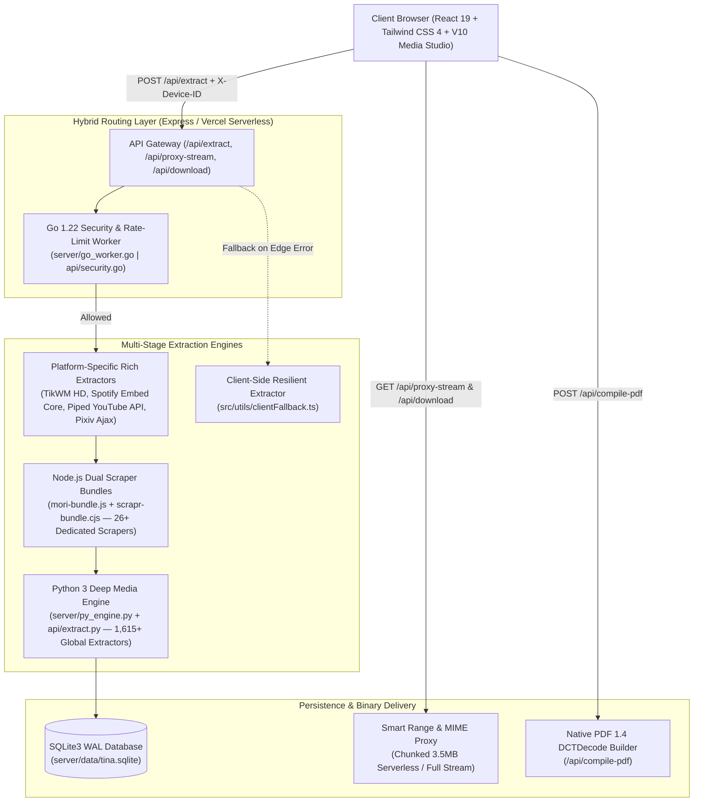

<div align="center">


<br />

# TINA DOWNLOADER

**Enterprise-Grade Multi-Engine Media Downloader, V10 Streaming Studio & Open REST API**  
*Dirancang dan dikembangkan oleh **[Nimzz (@NimzzAi)](https://github.com/NimzzAi)***

[](#direktori-1615-situs--platform)
[](#arsitektur-sistem--tri-engine-pipeline)
[](#panduan-deployment-vercel--self-hosted)
[](#filosofi-desain-monochrome-anti-slop-ui)
[-09090B?style=flat-square&labelColor=18181B)](#spesifikasi-lengkap-rest-api-v1)

[**Saluran WhatsApp Resmi**](https://whatsapp.com/channel/0029VbBhZWdGJP8HlbGaE63Q) · [**GitHub @NimzzAi**](https://github.com/NimzzAi) · [**Telegram @Nimzz4**](https://t.me/Nimzz4) · [**TikTok @nimzz_bocil_pokemon**](https://www.tiktok.com/@nimzz_bocil_pokemon)

</div>

---

## Daftar Isi

1. [Ikhtisar Eksekutif](#ikhtisar-eksekutif)
2. [Filosofi Desain: Monochrome Anti-Slop UI](#filosofi-desain-monochrome-anti-slop-ui)
3. [Fitur Unggulan & Kapabilitas V10 Studio](#fitur-unggulan--kapabilitas-v10-studio)
4. [Arsitektur Sistem & Tri-Engine Pipeline](#arsitektur-sistem--tri-engine-pipeline)
5. [Tautan Uji Coba Resmi (Verified Test Suite)](#tautan-uji-coba-resmi-verified-test-suite)
6. [Direktori 1.615+ Situs & Platform](#direktori-1615-situs--platform)
7. [Spesifikasi Lengkap REST API v1](#spesifikasi-lengkap-rest-api-v1)
8. [Contoh Integrasi Kode (cURL, TypeScript, Python, Go)](#contoh-integrasi-kode-curl-typescript-python-go)
9. [Struktur Direktori Proyek](#struktur-direktori-proyek)
10. [Instalasi Lokal & Pengembangan](#instalasi-lokal--pengembangan)
11. [Panduan Deployment (Vercel & Self-Hosted)](#panduan-deployment-vercel--self-hosted)
12. [Keamanan, Rate-Limiting & Privasi](#keamanan-rate-limiting--privasi)
13. [SEO, OpenGraph, JSON-LD & AI Crawlers](#seo-opengraph-json-ld--ai-crawlers)
14. [Profil Pengembang — Nimzz](#profil-pengembang--nimzz)

---

## Ikhtisar Eksekutif

**Tina Downloader** adalah platform ekstraktor media lintas situs dan pemutar streaming generasi terbaru (**V10 Media Studio**) yang mendukung pengunduhan **video multi-resolusi (hingga 4K/1080p 60fps tanpa watermark)**, **trek musik/audio original (MP3 320kbps & M4A)**, **galeri foto multi-slide (carousel)**, **kompilasi komik/manga menjadi dokumen PDF**, hingga **direct link resolver untuk penyimpanan cloud** dari lebih dari **1.615 situs global**.

Aplikasi ini memisahkan pengalaman pengguna harian dari kompleksitas teknis:
- **Antarmuka Utama yang Bersih & Cepat**: Pengguna cukup menempelkan tautan, menonton pratinjau langsung pada **V10 Video Player**, **V10 Audio Deck**, atau **Photo Carousel**, lalu mengunduh berkas dengan penamaan otomatis yang rapi (`Tina_Judul_Resolusi.mp4/.mp3/.jpg`).
- **Halaman Dokumentasi API & Developer Terpisah**: Seluruh spesifikasi endpoint REST API, skema JSON, *Live API Sandbox*, serta rincian arsitektur rekayasa oleh **Nimzz** diisolasi pada halaman khusus (`/api-docs` dan `/developer`).

---

## Filosofi Desain: Monochrome Anti-Slop UI

Antarmuka **Tina Downloader** dirancang mengikuti prinsip rekayasa desain presisi tinggi dari [**Impeccable Design**](https://github.com/pbakaus/impeccable), [**No-Slop UI**](https://github.com/LeoStehlik/no-slop-ui), dan [**Anti-UI-Slop**](https://github.com/github/awesome-copilot/tree/main/skills/anti-ui-slop):

| Prinsip Desain | Implementasi pada Tina Downloader |
| :--- | :--- |
| **Pure Monochrome Palette** | Kombinasi warna **Hitam (`#09090B`)**, **Putih (`#FFFFFF` / `#FAFAFA`)**, dan **Abu-abu Netral (`#F4F4F5` – `#27272A`)** dengan rasio kontras WCAG AAA tanpa gradasi neon atau dekorasi kosmetik berlebihan. |
| **Zero-Pill Discipline** | Seluruh tombol, filter, dan elemen interaktif menggunakan radius geometris tegas (`rounded-md` / `rounded-lg` / `rounded-xl`) dan garis batas 1px (`border-neutral-200` / `dark:border-neutral-800`). |
| **Typographic & Tabular Hierarchy** | Menggunakan pasangan font **Unbounded** (display), **Onest** (UI/body), dan **JetBrains Mono** (`tabular-nums`) untuk durasi waktu, ukuran berkas, kode status HTTP, dan penghitung direktori 1.615 situs. |
| **Complete 4-State Coverage** | Setiap tampilan memiliki penanganan eksplisit untuk kondisi **Idle/Empty**, **Loading (Shimmer Skeleton)**, **Success (V10 Studio)**, dan **Error/Fallback Recovery**. |
| **URL & Session Persistence** | Sinkronisasi penuh antara *pathname* URL (`/`, `/history`, `/sites`, `/api-docs`, `/about`, `/developer`), `window.history` (*Back/Forward*), `localStorage`, dan `sessionStorage` sehingga halaman tidak pernah kembali ke beranda secara tidak sengaja saat di-*refresh*. |

---

## Fitur Unggulan & Kapabilitas V10 Studio

### 1. V10 Custom Video Player & YouTube Direct Stream
- **Custom HTML5 HUD & Scrubber**: Kontrol play/pause, lompat waktu $\pm 5$ detik, pengatur volume, kecepatan putar (`0.75x`, `1x`, `1.25x`, `1.5x`, `2x`), *Picture-in-Picture (PiP)*, dan layar penuh.
- **Instant Resolution Switcher**: Berpindah antar resolusi (`1080p`, `720p`, `480p`) secara langsung dengan mempertahankan posisi detik pemutaran (*timestamp preservation*).
- **Hybrid YouTube & Proxy Failover**: Mendukung pemutaran langsung video YouTube melalui *V10 YouTube Direct Stream* maupun *HTML5 Native Proxy Stream* dengan injeksi header `Range` dan `Referer` otomatis agar bebas blokir CORS di Vercel maupun server mandiri.

### 2. V10 Audio Deck & Spotify Instant Stream
- **Dual-Mode Audio Playback**: Memutar trek musik MP3/M4A langsung di peramban melalui *V10 Audio Deck* (lengkap dengan sampul album HD, *timecode* `tabular-nums`, dan *seek bar*) serta menyediakan mode **Pemutar Resmi Spotify** terintegrasi untuk tautan `open.spotify.com`.
- **Automatic Token & MIME Resolution**: Menangani konversi token audio asinkron dan menjamin header `Content-Type: audio/mpeg` agar dapat diputar di seluruh peramban desktop dan seluler.

### 3. Multi-Slide Photo Carousel & Native PDF 1.4 Compiler
- **Interactive Slide Viewer**: Menampilkan galeri foto multi-slide dari TikTok Slideshow, Instagram Carousel, Pixiv Illustration, RedNote, dan komik/manga lengkap dengan strip *thumbnail* dan *Fullscreen Lightbox*.
- **Zero-Dependency PDF 1.4 Generator**: Menggabungkan hingga 60 slide foto resolusi penuh menjadi satu dokumen `.pdf` siap baca menggunakan parser dimensi biner (`SOF0/SOF2` JPEG & `IHDR` PNG) dan pembungkus objek `DCTDecode` PDF 1.4 murni.

### 4. Direktori 1.615+ Situs Instan (Build-Time Bundled)
- Daftar lengkap **1.615 ekstraktor situs** dibundel langsung pada waktu kompilasi sekaligus dilayani oleh endpoint `/api/supported-sites`, memastikan pencarian dan penyaringan kategori berjalan secara instan (0 ms latensi) baik di lingkungan lokal maupun Vercel Serverless.

---

## Arsitektur Sistem & Tri-Engine Pipeline

Tina Downloader mengadopsi arsitektur **Hybrid Multi-Runtime** yang berjalan mulus baik pada **Dedicated Node.js + Python + Go Server** maupun **Vercel Serverless Functions**:



---

## Tautan Uji Coba Resmi (Verified Test Suite)

Anda dapat menguji langsung keandalan ekstraksi dan pemutaran media menggunakan empat tautan referensi yang tersedia pada tombol **Coba contoh** di halaman utama:

| Skenario Uji | Platform | Tautan Uji Coba | Hasil Ekstraksi & Pemutaran |
| :--- | :--- | :--- | :--- |
| **1. Video & Audio Tanpa Watermark** | **TikTok** | `https://vm.tiktok.com/ZSgCBT3wv/` | Video 1080p Full HD (`H.264`), 720p HD tanpa watermark, 540p SD, dan Audio MP3 Original. |
| **2. Video Multi-Resolusi HD** | **YouTube** | `https://youtu.be/Sgt6yH9UM-c?si=dUP74ef5pdgEShXX` | *loh perasaan gak gini deh.. 😹 - REACT MEME KOCAK* oleh **Hitzeed** (`32:42`), V10 YouTube Direct Stream + Unduhan MP4 & MP3. |
| **3. Audio Track Musik 320kbps** | **Spotify** | `https://open.spotify.com/track/0wULafSHeHYZFu54R9ZFRJ` | *Mangu — Fourtwnty, Charita Utami* (`04:22`), V10 Audio Deck MP3 Stream + Pemutar Resmi Spotify + Cover Art HD. |
| **4. Galeri Foto Multi-Slide & PDF** | **Pixiv** | `https://www.pixiv.net/en/artworks/90000005` | Carousel multi-slide interaktif, pratinjau *Lightbox* layar penuh, unduh per slide `.JPG`, dan kompilasi `.PDF`. |

---

## Direktori 1.615+ Situs & Platform

Tina Downloader mengategorikan dukungan platform ke dalam 5 kelompok utama:

1. **Sosial & Video**: TikTok, YouTube (Video, Shorts, Music), Instagram (Reels, Post, Carousel, Stories), X / Twitter, Facebook Watch, Threads, Reddit, Pinterest, RedNote (Xiaohongshu), Douyin, CapCut, Kwai, SnackVideo, Vimeo, Dailymotion, Twitch, Kick, Rumble.
2. **Musik & Audio**: Spotify (Track & Episode), SoundCloud, Apple Music, Bandcamp, Mixcloud, Audiomack, Deezer, ZingMP3, Joox.
3. **Cloud & Berkas**: MediaFire, Google Drive, TeraBox, PixelDrain, GoFile.io, Mega.nz, Sfile.mobi, KrakenFiles, Catbox.moe, GitHub Releases, Linkvertise / LootLabs / Sub2Unlock Bypass.
4. **Komik & Anime**: Pixiv, Bilibili, MangaDex, Kiryuu, KomikCast, KomikIndo, Shinigami, Otakudesu, Nimegami, Samehadaku, Gogoanime.
5. **Ekstraktor Global (1.600+ Domain)**: Portal berita internasional & nasional, platform edukasi, arsip penyiaran publik, dan ekstraktor video HTML5/HLS/DASH universal.

---

## Spesifikasi Lengkap REST API v1

Seluruh endpoint REST API dapat diakses secara publik tanpa memerlukan registrasi API Key. Sertakan header opsional `X-Device-ID` untuk mengaitkan riwayat unduhan dan kuota perangkat.

### 1. `POST /api/extract` — Ekstraksi Metadata & Stream Media
Mengekstrak metadata lengkap serta daftar stream unduhan dari URL publik.

- **Request Headers**: `Content-Type: application/json`, `X-Device-ID: TINA-XXXX-XXXX` (opsional)
- **Request Body**:
```json
{
  "url": "https://open.spotify.com/track/0wULafSHeHYZFu54R9ZFRJ"
}
```
- **Response `200 OK`**:
```json
{
  "status": "ok",
  "data": {
    "title": "Mangu — Fourtwnty, Charita Utami",
    "author": "Fourtwnty, Charita Utami",
    "platform": "spotify",
    "extractorKey": "TinaCore::Spotify",
    "engine": "Tina Hybrid",
    "serverUsed": "Tina Hybrid Core (SPOTIFY)",
    "webpageUrl": "https://open.spotify.com/track/0wULafSHeHYZFu54R9ZFRJ",
    "thumbnail": "https://image-cdn-ak.spotifycdn.com/image/ab67616d0000b273fecb2b49d97ed68528fbf44a",
    "duration": "4:22",
    "uploadDate": "2022-04-20",
    "resolution": "320kbps HQ Audio",
    "acodec": "MP3 320kbps (44.1kHz)",
    "filesizeApprox": "10.5 MB",
    "downloads": [
      {
        "id": "sp_0wULafSHeHYZFu54R9ZFRJ_320",
        "type": "audio",
        "quality": "Audio Original 320kbps · Mangu (MP3)",
        "ext": "mp3",
        "url": "https://p.scdn.co/mp3-preview/44aa459ebfb8ecd39c5bedade153a61dffb5e369",
        "filesizeFormatted": "10.5 MB",
        "acodec": "MP3 320kbps",
        "resolution": "320kbps"
      }
    ]
  }
}
```

### 2. `GET /api/proxy-stream` — In-Browser Media Streaming Proxy
Mem-proxy stream video, audio, atau gambar dengan injeksi `Referer`, `User-Agent`, dukungan `Range: bytes=...` (`206 Partial Content`), serta koreksi otomatis `Content-Type`.

- **Query Parameters**:
  - `url` *(wajib)*: URL sumber stream.
  - `ext` *(opsional)*: Petunjuk ekstensi (`mp4`, `mp3`, `jpg`, `png`, `webp`).

### 3. `GET /api/download/:filename` — Unduhan Berkas Langsung
Mengalirkan berkas dengan header `Content-Disposition: attachment` dan penamaan file yang aman bagi sistem operasi.

- **Query Parameters**:
  - `url` *(wajib)*: URL sumber stream.
  - `filename` *(opsional)*: Nama dasar berkas.
  - `ext` *(opsional)*: Ekstensi berkas (`mp4`, `mp3`, `jpg`, `pdf`).

### 4. `POST /api/resolve` — Resolver Token Unduhan Asinkron
Menyelesaikan token internal (`spotidown_resolve:...`, `applemusic_resolve:...`, `youtube_resolve:...`, `ytmp3gg_resolve:...`) menjadi URL CDN langsung.

### 5. `POST /api/compile-pdf` — Kompilator Galeri Foto ke PDF
Menggabungkan array URL gambar menjadi satu berkas PDF 1.4 siap unduh.

```json
{
  "title": "Tina_Gallery_Pixiv",
  "images": [
    "https://i.pixiv.re/img-master/img/2021/05/22/00/33/36/90000005_p0_master1200.jpg",
    "https://i.pixiv.re/img-master/img/2021/05/22/00/33/36/90000005_p1_master1200.jpg"
  ]
}
```

### 6. `GET /api/supported-sites` — Direktori Situs & Pencarian
Mengambil daftar seluruh platform yang didukung (`total: 1615`). Mendukung query `?q=keyword&category=all`.

### 7. `GET /api/history` & `DELETE /api/history` — Riwayat Perangkat
Mengambil atau menghapus riwayat unduhan berdasarkan kombinasi `X-Device-ID` dan alamat IP.

---

## Contoh Integrasi Kode (cURL, TypeScript, Python, Go)

### cURL
```bash
curl -X POST "https://tina-downloader.web.id/api/extract" \
  -H "Content-Type: application/json" \
  -H "X-Device-ID: TINA-CLI-CLIENT" \
  -d '{"url": "https://open.spotify.com/track/0wULafSHeHYZFu54R9ZFRJ"}'
```

### TypeScript / Node.js
```typescript
interface ExtractResponse {
  status: string;
  data: {
    title: string;
    author: string;
    platform: string;
    duration: string;
    downloads: Array<{
      id: string;
      type: 'video' | 'audio' | 'image' | 'file';
      quality: string;
      ext: string;
      url: string;
    }>;
  };
}

async function extractMedia(targetUrl: string): Promise<ExtractResponse> {
  const response = await fetch('https://tina-downloader.web.id/api/extract', {
    method: 'POST',
    headers: {
      'Content-Type': 'application/json',
      'X-Device-ID': 'TINA-NODE-SDK',
    },
    body: JSON.stringify({ url: targetUrl }),
  });

  if (!response.ok) {
    throw new Error(`HTTP ${response.status}: Gagal mengekstrak media`);
  }
  return response.json();
}
```

### Python 3
```python
import requests

resp = requests.post(
    "https://tina-downloader.web.id/api/extract",
    headers={"Content-Type": "application/json", "X-Device-ID": "TINA-PY-SDK"},
    json={"url": "https://youtu.be/Sgt6yH9UM-c?si=dUP74ef5pdgEShXX"},
    timeout=30,
)
payload = resp.json()
media = payload["data"]
print(f"Judul   : {media['title']}")
print(f"Kreator : {media['author']} ({media['duration']})")
for stream in media["downloads"]:
    print(f" - [{stream['type'].upper()}] {stream['quality']} -> {stream['url']}")
```

### Go (Golang)
```go
package main

import (
	"bytes"
	"fmt"
	"io"
	"net/http"
)

func main() {
	body := []byte(`{"url":"https://vm.tiktok.com/ZSgCBT3wv/"}`)
	req, _ := http.NewRequest("POST", "https://tina-downloader.web.id/api/extract", bytes.NewBuffer(body))
	req.Header.Set("Content-Type", "application/json")
	req.Header.Set("X-Device-ID", "TINA-GO-SDK")

	resp, err := http.DefaultClient.Do(req)
	if err != nil {
		panic(err)
	}
	defer resp.Body.Close()

	raw, _ := io.ReadAll(resp.Body)
	fmt.Println(string(raw))
}
```

---

## Struktur Direktori Proyek

```text
tina-downloader/
├── api/
│   ├── extract.py                  # Serverless Python Extractor, Stream Proxy & Resolver (Vercel)
│   └── security.go                 # Serverless Golang Rate-Limit & Fingerprint Endpoint (Vercel)
├── plugins/
│   └── siteMeta.ts                 # Vite Plugin: SEO, OpenGraph, JSON-LD, robots.txt, sitemap.xml, llms.txt
├── public/
│   ├── assets/markdown/
│   │   └── supportedsites_cb2590be.md # Direktori sumber 1.615+ situs didukung
│   ├── avatar.jpg                  # Foto profil resmi pengembang (Nimzz)
│   ├── banner.jpg                  # Sampul halaman profil pengembang
│   ├── logo.png                    # Logo resmi Tina Downloader
│   ├── og-image.jpg                # Gambar OpenGraph / Social Share Card
│   ├── readme.jpg                  # Banner dokumentasi README & showcase
│   └── thumbnail.jpg               # Ilustrasi viewfinder beranda utama
├── server/
│   ├── data/                       # Penyimpanan SQLite3 (tina.sqlite) & state rate-limit Go
│   ├── engines/                    # Bundel scraper Node.js (mori, scrapr), worker Go, & binary yt-dlp
│   ├── go_worker.go                # Kode sumber worker keamanan & HTTP header prober (Go 1.22)
│   └── py_engine.py                # Mesin ekstraksi mendalam & pengelola database SQLite3 (Python 3)
├── src/
│   ├── components/
│   │   ├── ApiDocsPage.tsx         # Halaman Dokumentasi REST API v1 & Live JSON Sandbox
│   │   ├── DeveloperPage.tsx       # Halaman Profil Pengembang (Nimzz) & cetak biru modul
│   │   └── V10MediaPlayer.tsx      # Komponen V10 Video Player (HTML5 + YouTube) & V10 Audio Deck
│   ├── utils/
│   │   ├── clientFallback.ts       # Bundel 1.615 situs & ekstraktor cadangan sisi klien
│   │   └── deviceFingerprint.ts    # Generator SHA-256 Device ID deterministik
│   ├── App.tsx                     # Aplikasi utama dengan sinkronisasi rute URL & penyimpanan sesi
│   ├── index.css                   # Sistem desain monokrom (Hitam/Putih/Abu-abu) & token tipografi
│   ├── main.tsx                    # Entry point React 19
│   └── types.ts                    # Definisi antarmuka TypeScript
├── .npmrc                          # Konfigurasi resolusi dependensi npm untuk Vercel CI/CD
├── package.json                    # Skrip manajemen proyek & dependensi
├── server.ts                       # Server orkestrasi full-stack Express + Vite
├── site.config.ts                  # Konfigurasi terpusat metadata SEO & warna tema monokrom
├── vercel.json                     # Konfigurasi rute SPA, Serverless Functions, & Cache-Control Vercel
└── vite.config.ts                  # Konfigurasi bundler Vite 8 & Tailwind CSS 4
```

---

## Instalasi Lokal & Pengembangan

### Prasyarat Sistem
- **Node.js** `>= 20.x` (Direkomendasikan `v22 LTS`)
- **Python** `>= 3.10` (Beserta modul standar `sqlite3` dan `urllib`)
- **Go (Golang)** `>= 1.22` *(Opsional — binary `server/engines/tina-go-worker` sudah dikompilasi)*

### Langkah Menjalankan Secara Lokal

```bash
# 1. Clone repositori
git clone https://github.com/NimzzAi/tina.git
cd tina

# 2. Instal seluruh dependensi Node.js
npm install

# 3. Jalankan server pengembangan full-stack (Port 3000)
npm run dev
```

Buka `http://localhost:3000` di peramban Anda.

### Mengompilasi Ulang Binary Go Worker (Opsional)
```bash
go build -o server/engines/tina-go-worker server/go_worker.go
```

---

## Panduan Deployment (Vercel & Self-Hosted)

### Opsi A: Deployment ke Vercel (Serverless Hybrid)
Proyek ini telah dikonfigurasi penuh untuk **Vercel** menggunakan `vercel.json` dan `.npmrc`:
1. Hubungkan repositori GitHub Anda ke dashboard Vercel.
2. Vercel secara otomatis membaca `.npmrc` (`legacy-peer-deps=true`) dan menjalankan `npm run build` (`vite build`).
3. Rute API (`/api/extract`, `/api/proxy-stream`, `/api/download/*`, `/api/resolve`, `/api/supported-sites`, `/api/history`) diarahkan ke fungsi serverless Python (`api/extract.py`) dan Go (`api/security.go`).
4. Rute navigasi halaman (`/history`, `/sites`, `/api-docs`, `/about`, `/developer`) diarahkan dengan aman ke SPA `index.html` sehingga tahan terhadap *refresh* halaman.

### Opsi B: Deployment ke VPS / Dedicated Server / Docker
Untuk performa penuh tanpa batas ukuran payload 4.5 MB milik serverless:
```bash
# Build aset produksi frontend
npm run build

# Jalankan server produksi Node.js + Python + Go
NODE_ENV=production PORT=3000 npm start
```

---

## Keamanan, Rate-Limiting & Privasi

1. **Dual-Identity Rate Limiting**: Menggabungkan alamat IP (`X-Forwarded-For` / `CF-Connecting-IP`) dan *Deterministic Device Fingerprint* (`X-Device-ID`) dengan batas wajar **15 permintaan ekstraksi per 15 menit** dan proteksi *burst* **5 permintaan per 20 detik**.
2. **Privasi Tanpa Akun**: Pengguna tidak perlu mendaftar atau masuk (*login*). Riwayat unduhan disimpan secara terisolasi per perangkat di `localStorage` dan SQLite3.
3. **Sanitasi Header & Filename**: Seluruh nama berkas unduhan disanitasi dari karakter ilegal dan dikirim bersama header `X-Content-Type-Options: nosniff`.

---

## SEO, OpenGraph, JSON-LD & AI Crawlers

Plugin kustom `plugins/siteMeta.ts` secara otomatis menyuntikkan metadata SEO dan menghasilkan berkas indeks pada saat *build*:
- **Structured Data (Schema.org JSON-LD)**: `WebSite`, `WebApplication`, dan `Organization`.
- **Social Cards**: Tag OpenGraph (`og:title`, `og:description`, `og:image`) dan Twitter Summary Large Image.
- **Generated Indexing Files**: `/robots.txt`, `/sitemap.xml`, `/manifest.webmanifest`, dan `/llms.txt` untuk keterbacaan mesin pencari modern.

---

## Profil Pengembang — Nimzz

<div align="center">


### **Nimzz (`@NimzzAi`)**
*Full-Stack Software Engineer, Web Tooling Architect & Creator of Tina Downloader*

</div>

| Saluran Resmi | Identitas / Handle | Tautan Langsung |
| :--- | :--- | :--- |
| **WhatsApp Channel** | Saluran Resmi Nimzz | [whatsapp.com/channel/0029VbBhZWdGJP8HlbGaE63Q](https://whatsapp.com/channel/0029VbBhZWdGJP8HlbGaE63Q) |
| **GitHub** | `@NimzzAi` | [github.com/NimzzAi](https://github.com/NimzzAi) |
| **Telegram** | `@Nimzz4` | [t.me/Nimzz4](https://t.me/Nimzz4) |
| **TikTok** | `@nimzz_bocil_pokemon` | [tiktok.com/@nimzz_bocil_pokemon](https://www.tiktok.com/@nimzz_bocil_pokemon) |

---

<div align="center">
  <sub>Dibangun dengan dedikasi oleh <strong>Nimzz</strong> · © 2026 Tina Downloader. Seluruh hak cipta dilindungi.</sub>
</div>