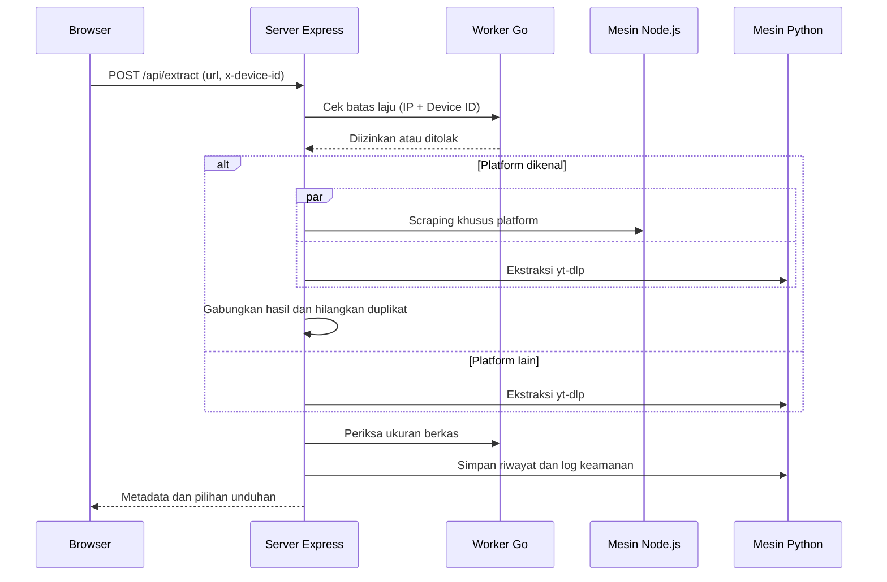

<p align="center">
  
</p>

<h1 align="center">Tina Downloader</h1>

<p align="center">
  Pengunduh video, audio, dan gambar dengan ekstraksi metadata otomatis dari berbagai platform.
</p>

<p align="center">
  
  
  
  
  
  
  
</p>

## Daftar Isi

- [Ringkasan](#ringkasan)
- [Fitur](#fitur)
- [Platform yang Didukung](#platform-yang-didukung)
- [Cara Kerja](#cara-kerja)
- [Struktur Proyek](#struktur-proyek)
- [Memulai](#memulai)
- [Perintah](#perintah)
- [Konfigurasi Situs dan SEO](#konfigurasi-situs-dan-seo)
- [Referensi API](#referensi-api)
- [Pembatasan Laju dan Keamanan](#pembatasan-laju-dan-keamanan)
- [Penyimpanan Data](#penyimpanan-data)
- [Deploy](#deploy)
- [Desain Antarmuka](#desain-antarmuka)
- [Pemecahan Masalah](#pemecahan-masalah)
- [Catatan Penggunaan](#catatan-penggunaan)
- [Penulis](#penulis)

## Ringkasan

Tina Downloader adalah aplikasi web satu halaman untuk mengambil media dari tautan yang ditempel pengguna. Aplikasi membaca tautan, menampilkan metadata (judul, pembuat, durasi, resolusi, codec) beserta pilihan kualitas yang tersedia, lalu mengunduh media yang dipilih. Semua fungsi juga tersedia sebagai REST API.

Backend memakai tiga mesin yang bekerja bersama: mesin Node.js untuk scraping khusus per platform, mesin Python yang menjalankan yt-dlp untuk cakupan situs yang luas, dan worker Go untuk pembatasan laju permintaan.

## Fitur

**Pengunduhan**

- Video dalam beberapa pilihan resolusi, audio MP3, dan galeri foto (carousel atau slideshow).
- Penyusunan beberapa gambar menjadi satu berkas PDF.
- Proxy stream dengan dukungan header `Range`, sehingga media dapat diputar dan diunduh melalui server.
- Hanya satu item per tautan. Playlist tidak diproses.

**Metadata**

- Judul, pembuat, platform, durasi, tanggal unggah, resolusi, FPS, codec video dan audio, ukuran perkiraan, tag, dan kategori.
- Statistik jika tersedia dari sumber: jumlah penonton, suka, dan komentar.
- Ukuran berkas diperiksa langsung dari URL unduhan bila belum diketahui.

**Aplikasi**

- Riwayat unduhan per perangkat, dengan opsi hapus satu entri atau seluruhnya.
- Tema terang dan gelap.
- Enam tab: Beranda Unduhan, Riwayat Unduhan, Daftar Situs, Dokumentasi API, Tentang & FAQ, dan Profil Pengembang.
- Dokumentasi API interaktif dengan contoh kode cURL, JavaScript, Python, dan Go.

**Keamanan**

- Pembatasan laju berdasarkan kombinasi alamat IP dan Device ID.
- Log keamanan untuk setiap permintaan ekstraksi.

## Platform yang Didukung

| Jalur | Platform |
| --- | --- |
| Mesin khusus (Node.js) | TikTok, Instagram, Facebook, YouTube, X (Twitter), Pinterest, Pixiv, Bilibili, Douyin, RedNote, SoundCloud, Spotify, Apple Music, Bandcamp, Threads |
| yt-dlp (Python) | Ribuan situs lain yang didukung yt-dlp |

Daftar situs yang dikenali aplikasi dapat dilihat di tab Daftar Situs atau lewat endpoint `GET /api/supported-sites`.

## Cara Kerja

Alur permintaan ekstraksi (`POST /api/extract`):



Beberapa catatan dari implementasinya:

- Untuk platform yang dikenal, hasil dari mesin Node.js dan yt-dlp digabung dan duplikatnya dibuang. Jumlah pilihan unduhan dibatasi. TikTok memiliki satu langkah ekstraksi tambahan untuk data yang lebih lengkap.
- Panggilan yt-dlp memakai `--no-playlist` dan batas waktu 28 detik.
- Hasil akhir diberi label mesin `Tina Hybrid`.
- Jika worker Go gagal dijalankan, server memakai nilai bawaan dan tetap memproses permintaan.

## Struktur Proyek

```text
api/
  extract.py            Fungsi Python untuk Vercel (ekstraksi lewat yt-dlp)
  security.go           Fungsi Go untuk Vercel (pembatasan laju)
plugins/
  siteMeta.ts           Plugin Vite: meta tag, JSON-LD, robots, sitemap, manifest, llms.txt
public/                 Ikon, gambar Open Graph, gambar README, daftar situs
server/
  engines/              Mesin Node.js, biner yt-dlp, dan biner worker Go
  data/                 Database SQLite dan state pembatasan laju
  go_worker.go          Sumber worker Go
  py_engine.py          Sumber mesin Python
src/
  App.tsx               Halaman utama dan state aplikasi
  components/           Dokumentasi API dan pemutar media
  utils/                Pembuat Device ID
  index.css             Token desain dan gaya dasar
  types.ts              Tipe data bersama
server.ts               Server Express dan semua endpoint /api
site.config.ts          Konfigurasi situs
vercel.json             Konfigurasi deploy Vercel
requirements.txt        Dependensi Python untuk fungsi serverless
```

## Memulai

### Prasyarat

- Node.js 22 atau lebih baru
- Python 3 (server memanggilnya sebagai `python3`)
- Linux x86-64 untuk biner bawaan. Platform lain memerlukan build ulang worker Go.

Biner yt-dlp sudah disertakan di `server/engines/yt-dlp`, jadi tidak perlu dipasang terpisah untuk menjalankan secara lokal.

### Instalasi

Di folder proyek, jalankan:

```bash
npm install
npm run dev
```

Aplikasi berjalan di `http://localhost:3000`. Port ini ditetapkan sebagai konstanta `PORT` di `server.ts`.

Saat server mulai, izin eksekusi biner `tina-go-worker` dan `yt-dlp` diatur otomatis.

### Membangun Ulang Worker Go

Jika biner bawaan tidak cocok dengan platform kamu:

```bash
go build -o server/engines/tina-go-worker server/go_worker.go
```

## Perintah

| Perintah | Keterangan |
| --- | --- |
| `npm run dev` | Menjalankan server pengembangan (Express dengan middleware Vite) |
| `npm run build` | Membangun klien ke folder `dist/` |
| `npm start` | Menjalankan `server.ts`. Dengan `NODE_ENV=production`, server menyajikan isi `dist/` |
| `npm run preview` | Pratinjau hasil build lewat Vite |
| `npm run lint` | Pemeriksaan tipe TypeScript |
| `npm run clean` | Menghapus `dist/` dan `server.js` |

## Konfigurasi Situs dan SEO

Seluruh pengaturan metadata ada di `site.config.ts`. Tidak ada variabel lingkungan yang diperlukan. Baris pertama berkas berisi URL publik situs:

```ts
const SITE_URL = 'https://tina-downloader.web.id';
```

Ubah nilai ini ke domain yang sebenarnya sebelum build.

### Isi Konfigurasi

| Field | Fungsi |
| --- | --- |
| `url` | URL publik situs, dipakai untuk canonical, Open Graph, sitemap, dan robots |
| `name`, `shortName`, `title` | Nama aplikasi, nama pendek untuk manifest, dan judul halaman |
| `description`, `summary` | Deskripsi singkat untuk meta tag dan ringkasan untuk JSON-LD serta `llms.txt` |
| `locale`, `language` | Contoh `id_ID` dan `id` |
| `author`, `links.github` | Penulis dan tautan profil |
| `applicationCategory`, `priceCurrency` | Data terstruktur schema.org |
| `keywords`, `features` | Kata kunci, serta daftar fitur untuk JSON-LD, `<noscript>`, dan `llms.txt` |
| `api` | Daftar endpoint yang ditulis ke `llms.txt` |
| `themeColor` | Warna tema terang dan gelap |
| `ogImage` | Path, ukuran, tipe, dan teks alternatif gambar Open Graph |
| `googleSiteVerification`, `bingSiteVerification` | Token verifikasi kepemilikan situs |

### Hasil Build

Plugin `plugins/siteMeta.ts` membaca konfigurasi tersebut dan menghasilkan:

- Meta tag SEO, canonical, Open Graph, Twitter Card, dan data terstruktur JSON-LD di `index.html`.
- Ringkasan konten di dalam `<noscript>` untuk crawler yang tidak menjalankan JavaScript.
- `robots.txt` yang mengizinkan mesin pencari dan crawler AI utama, dengan `/api/` dikecualikan.
- `sitemap.xml`, `manifest.webmanifest`, dan `llms.txt` di folder `dist/`.

Berkas-berkas ini juga dilayani saat pengembangan, sehingga bisa diperiksa di `http://localhost:3000/robots.txt` dan sejenisnya.

### Mendaftarkan ke Mesin Pencari

1. Pastikan `SITE_URL` sudah sesuai domain, lalu deploy.
2. Tambahkan situs sebagai properti di Google Search Console, lalu verifikasi. Metode meta tag memakai field `googleSiteVerification`.
3. Kirim `https://domain-kamu/sitemap.xml` di menu Sitemap.
4. Ulangi di Bing Webmaster Tools dengan `bingSiteVerification`.

Sitemap hanya berisi halaman utama, karena tab aplikasi tidak memiliki URL sendiri. Crawler AI umumnya tidak menjalankan JavaScript, jadi yang terbaca dari situs ini terbatas pada meta tag, JSON-LD, ringkasan `<noscript>`, dan `llms.txt`.

## Referensi API

Semua endpoint berada di bawah `/api`. CORS terbuka untuk semua origin, dan ukuran body JSON dibatasi 5 MB.

**Header**

| Header | Keterangan |
| --- | --- |
| `x-device-id` | Opsional. 4 sampai 128 karakter dari `a-z`, `A-Z`, `0-9`, `_`, dan `-`. Dipakai untuk pembatasan laju dan riwayat. Jika kosong atau tidak valid, server memakai `TINA-DEV-UNIDENTIFIED` |

### POST /api/extract

Membaca tautan dan mengembalikan metadata beserta pilihan unduhan.

```bash
curl -X POST "http://localhost:3000/api/extract" \
  -H "Content-Type: application/json" \
  -H "x-device-id: contoh-perangkat-001" \
  -d '{"url": "https://www.tiktok.com/@akun/video/1234567890"}'
```

Respons sukses (dipersingkat):

```json
{
  "status": "ok",
  "data": {
    "title": "Judul video",
    "author": "akun",
    "platform": "TikTok",
    "engine": "Tina Hybrid",
    "webpageUrl": "https://www.tiktok.com/@akun/video/1234567890",
    "thumbnail": "https://...",
    "duration": "0:32",
    "downloads": [
      {
        "type": "video",
        "quality": "1080p",
        "ext": "mp4",
        "url": "https://...",
        "filesizeFormatted": "8.4 MB"
      },
      {
        "type": "audio",
        "quality": "MP3",
        "ext": "mp3",
        "url": "https://..."
      }
    ]
  },
  "historyItem": { "id": "...", "createdAt": 1767225600000 },
  "rateLimit": { "allowed": true }
}
```

Bentuk lengkap objek `data` mengikuti antarmuka `MediaMetadata` di `src/types.ts`. Setiap elemen `downloads` mengikuti `DownloadStream`:

| Field | Keterangan |
| --- | --- |
| `type` | `video`, `audio`, `image`, `file`, `link`, atau `subtitle` |
| `quality`, `ext` | Label kualitas dan ekstensi berkas |
| `url` | URL sumber media |
| `filesize`, `filesizeFormatted` | Ukuran berkas bila diketahui |
| `vcodec`, `acodec`, `fps`, `tbr`, `resolution` | Detail teknis bila tersedia |
| `needsResolve` | `true` bila URL perlu diselesaikan lewat `POST /api/resolve` sebelum dipakai |

Kode galat:

| Status | Penyebab |
| --- | --- |
| `400` | URL kosong atau tidak diawali `http://` atau `https://` |
| `429` | Batas laju tercapai |
| `500` | Ekstraksi gagal |

Semua galat dikembalikan sebagai `{ "error": "pesan" }`.

### POST /api/resolve

Menyelesaikan tautan unduhan yang bertanda `needsResolve`.

```json
{ "tokenUrl": "..." }
```

Respons: `{ "status": "ok", "url": "..." }`. Status `400` jika `tokenUrl` tidak valid, `500` jika gagal.

### POST /api/compile-pdf

Mengunduh sejumlah gambar lalu menyusunnya menjadi satu PDF.

```json
{ "images": ["https://.../1.jpg", "https://.../2.jpg"], "title": "galeri-foto" }
```

`title` bersifat opsional dan bernilai bawaan `tina-comic`. Respons berupa berkas `application/pdf` sebagai lampiran. Status `400` jika daftar gambar kosong, `500` jika pengunduhan atau pembuatan PDF gagal.

### GET /api/proxy-stream

Meneruskan stream media dari sumber, termasuk permintaan `Range`.

| Query | Keterangan |
| --- | --- |
| `url` | Wajib. URL media sumber |
| `ext` | Opsional. Petunjuk ekstensi untuk menentukan `Content-Type` |

Status `400` untuk URL tidak valid, `502` jika sumber gagal dimuat.

### GET /api/download/:filename

Mengunduh media sebagai lampiran.

| Query | Keterangan |
| --- | --- |
| `url` | Wajib. URL media sumber, harus diawali `http://` atau `https://` |
| `filename` | Opsional. Nama berkas, menggantikan parameter path |
| `ext` | Opsional. Ekstensi berkas |

### GET /api/supported-sites

Daftar platform yang dikenali aplikasi. Mendukung query `q` untuk pencarian dan `category` untuk filter kategori.

### Riwayat

Ketiga endpoint ini terikat pada kombinasi `x-device-id` dan alamat IP.

| Endpoint | Respons |
| --- | --- |
| `GET /api/history` | `{ "items": [...] }`, setiap item mengikuti `HistoryItem` |
| `DELETE /api/history/:id` | `{ "status": "ok" }`, menghapus satu entri |
| `DELETE /api/history` | `{ "status": "ok" }`, menghapus seluruh riwayat |

## Pembatasan Laju dan Keamanan

- **Batas laju**: 15 permintaan ekstraksi per 15 menit, dengan batas burst 5 permintaan per 60 detik. Penghitungan dilakukan oleh worker Go berdasarkan alamat IP dan Device ID.
- **Device ID**: dibuat di browser dan disimpan di `localStorage` dengan kunci `tina_device_fingerprint_v1`. Karena dibuat di sisi klien, nilainya bukan identitas yang dapat dipercaya penuh.
- **Alamat IP klien**: diambil berurutan dari header `X-Forwarded-For` (nilai pertama), `X-Real-IP`, lalu alamat soket. Jika server berjalan di belakang reverse proxy, pastikan proxy menimpa `X-Forwarded-For` dengan alamat klien yang sebenarnya. Tanpa itu, klien dapat memalsukan header tersebut dan menghindari batas laju.
- **Kegagalan worker**: jika worker Go tidak dapat dijalankan, server memakai nilai bawaan dan tetap memproses permintaan, sehingga pembatasan laju tidak berlaku.
- **CORS**: terbuka untuk semua origin. Batasi di `server.ts` bila API tidak ditujukan untuk publik.

## Penyimpanan Data

| Berkas | Isi |
| --- | --- |
| `server/data/tina.sqlite` | Riwayat unduhan dan log keamanan |
| `server/data/go-ratelimit.json` | State pembatasan laju |

Data ini mencakup alamat IP, Device ID, user agent (dipotong hingga 256 karakter), dan URL yang diminta. Berkas yang ada di repositori hanya berisi data uji lokal. Jangan mengomit database produksi ke repositori publik.

## Deploy

### Server Node.js Sendiri

Mode ini menjalankan seluruh fitur, termasuk riwayat, pembuatan PDF, dan proxy stream.

```bash
npm install
npm run build
NODE_ENV=production npm start
```

Server menyajikan isi `dist/` pada port 3000. Letakkan reverse proxy di depannya untuk HTTPS dan domain, serta teruskan alamat klien lewat `X-Forwarded-For`.

### Vercel

`vercel.json` membangun klien statis dari `package.json` (output `dist/`) dan mendaftarkan dua fungsi serverless: `api/extract.py` dan `api/security.go`. Rute `/api/py/*` diarahkan ke fungsi Python, `/api/go/*` ke fungsi Go, dan permintaan lain ke `index.html`. Dependensi Python fungsi tersebut didaftarkan di `requirements.txt`.

Server Express beserta mesin lokalnya tidak ikut ter-deploy di Vercel. Fitur yang bergantung pada `server.ts`, seperti riwayat SQLite, pembuatan PDF, dan proxy stream, hanya tersedia saat aplikasi dijalankan di server Node.js sendiri.

## Desain Antarmuka

Semua token desain berada di `src/index.css`.

- **Warna**: skala `neutral` didefinisikan ulang dengan tinta navy. Variabel `--paper`, `--surface`, `--ink`, dan `--accent` berganti nilai saat kelas `dark` aktif.
- **Tipografi**: Unbounded untuk logo dan judul `h1`, Onest untuk antarmuka, JetBrains Mono untuk data teknis.
- **Bingkai pembidik**: ilustrasi di bagian atas halaman dikelilingi empat sudut bingkai. Saat ekstraksi berjalan, kelas `is-scanning` menyempitkan sudut dan menggerakkan garis pindai.
- **Aksesibilitas**: indikator fokus keyboard memakai warna aksen, dan semua animasi dimatikan untuk pengguna dengan `prefers-reduced-motion`.

## Pemecahan Masalah

| Gejala | Penyebab dan solusi |
| --- | --- |
| Ekstraksi selalu gagal | Pastikan `python3` tersedia di PATH. Biner yt-dlp di `server/engines` adalah skrip Python |
| Pembatasan laju tidak berlaku | Worker Go gagal dijalankan. Biner bawaan hanya untuk Linux x86-64, bangun ulang dengan perintah `go build` di atas |
| Galat `429` | Batas 15 permintaan per 15 menit tercapai. Tunggu hingga jendela waktu berakhir |
| Ekstraksi gagal untuk satu situs saja | Situs tersebut mungkin berubah. Perbarui `server/engines/yt-dlp` ke versi terbaru |
| Port 3000 sudah dipakai | Hentikan proses lain, atau ubah konstanta `PORT` di `server.ts` |
| Sitemap ditolak Search Console | Host pada `SITE_URL` tidak sama dengan properti yang didaftarkan |
| Fitur riwayat atau PDF tidak ada di Vercel | Ini sesuai desain. Jalankan di server Node.js sendiri |

## Catatan Penggunaan

Tina Downloader hanya mengambil media dari tautan yang diberikan pengguna. Hak cipta atas konten tetap dimiliki pemilik aslinya, dan pengguna bertanggung jawab mematuhi ketentuan layanan masing-masing platform. Platform dapat mengubah struktur situsnya kapan saja, sehingga mesin ekstraksi perlu diperbarui secara berkala.

## Penulis

Dibuat oleh Nimzz. GitHub: [NimzzAI](https://github.com/NimzzAI).